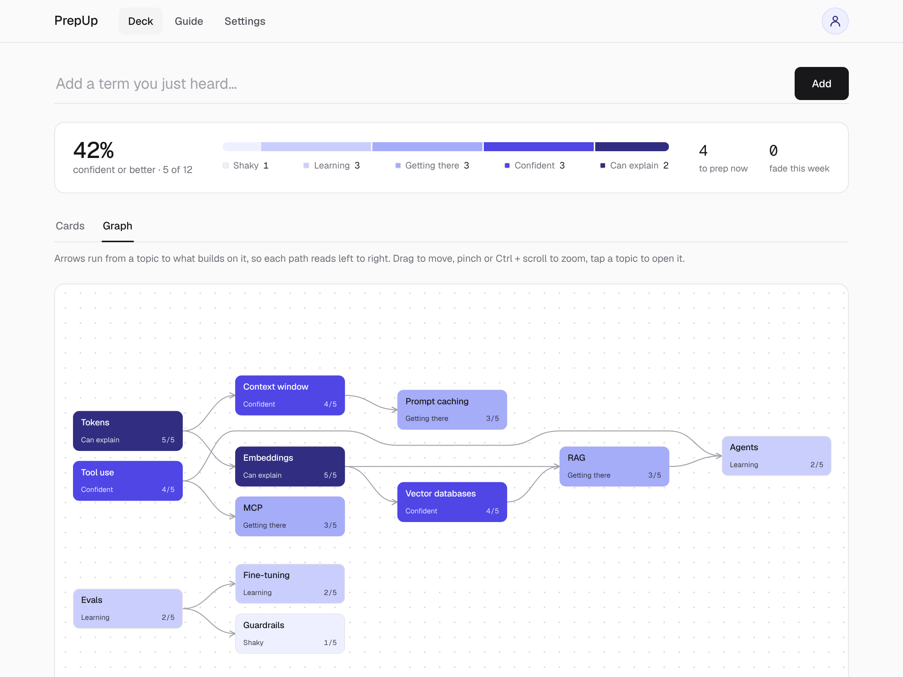

<div align="center">


# PrepUp

**Keep track of what you're learning, and let your own AI assistant test you on it.**

[](https://github.com/Solivagant14/prepup/actions/workflows/ci.yml)
[](LICENSE)
[](CONTRIBUTING.md)

[**Try it**](https://prepup.site) · [Guide](https://prepup.site/guide) · [Run your own](docs/self-hosting.md) · [Contribute](CONTRIBUTING.md)

</div>


PrepUp is a tracker for anything you're trying to learn: interview topics, exam material, the vocabulary of a new field. Each topic is a card with a score from 1 to 5. An AI assistant you already use tests you, and the card darkens as the topic sticks.

## How it works

1. **Capture.** Type a term, or tell your assistant "add RAG to PrepUp". It becomes a card.
2. **Get tested.** Say "test me on my PrepUp topics". Your assistant picks what's weak or fading, asks one topic at a time, and suggests a score. Nothing is saved until you say yes.
3. **Watch it fade.** A score drops one step every 14 days unless you're tested again, so the deck shows what you know *now*.
4. **See how topics connect.** Topics can build on other topics, and the graph view draws your deck as a learning path.



## No AI of its own

PrepUp only keeps the record. All testing runs in your own AI app, on your own plan, through an MCP connector (MCP is the open standard that lets AI apps use outside tools).

It works with any app that can add a remote MCP server. The [guide](https://prepup.site/guide/connect) has steps for Claude, ChatGPT, Cursor and VS Code. Claude is the only one tested so far; the others are marked as untested.

## Get started

1. Open [prepup.site](https://prepup.site) and create an account.
2. Add two or three terms you want to learn.
3. Follow [Connect your assistant](https://prepup.site/guide/connect) for the app you use.
4. Start a new chat and say **"test me on my PrepUp topics"**.

The hosted copy is free and runs on free hosting plans. Its [costs page](https://prepup.site/costs) shows what it costs to run and the limits each person gets. Only you can read your deck, and **Erase all my data** in Settings removes it.

## Run your own

PrepUp is one Vercel project and one Supabase project, both on free plans. See [Run your own PrepUp](docs/self-hosting.md).

## Contribute

Bug reports, ideas and pull requests are welcome. Tests run with no database or Docker to set up:

```bash
corepack enable && pnpm install
pnpm test
```

[CONTRIBUTING.md](CONTRIBUTING.md) covers local setup and how to send a change. [docs/architecture.md](docs/architecture.md) explains how the code fits together and the rules it keeps.

## Documentation

| | |
|---|---|
| [Using PrepUp](https://prepup.site/guide) | The guide: scores, fading, links, connecting an assistant, troubleshooting |
| [Architecture](docs/architecture.md) | How it's built, the rules, and why |
| [Run your own](docs/self-hosting.md) | Self-hosting on Vercel and Supabase |
| [Configuration](docs/configuration.md) | Every environment variable |
| [Changelog](CHANGELOG.md) | What has shipped |

## What's next

There is no fixed roadmap. PrepUp grows as ideas prove useful. Have an idea? [Start a discussion](https://github.com/Solivagant14/prepup/discussions).

## License

[MIT](LICENSE)
