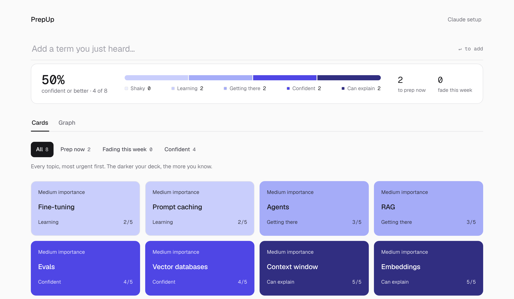
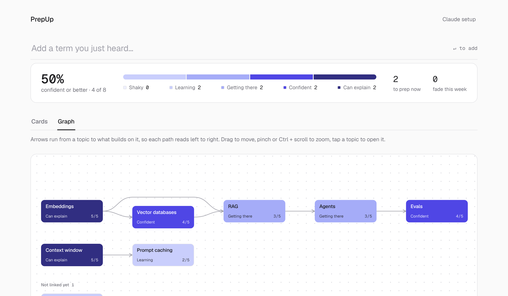
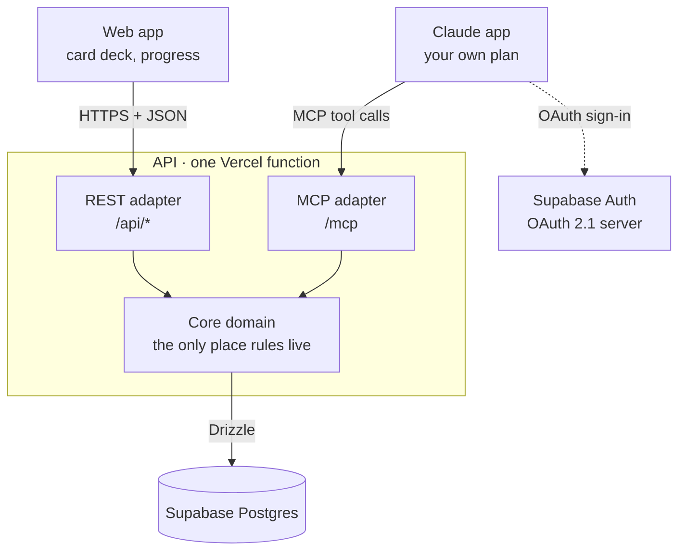

# PrepUp

A tracker for the things you're trying to learn: interview topics, exam material, the vocabulary of a new field. Add a term the moment you hear it, let Claude test you on it, and watch your deck darken as it sticks.

**Try it: [prepup-amber.vercel.app](https://prepup-amber.vercel.app)**. Free, sign in with Google.



## How it works

1. **Capture.** Type a term into the box, or tell Claude "add RAG to PrepUp". It becomes a card with a score from 1 to 5.
2. **Get tested.** Ask Claude "test me on my PrepUp topics". It picks what's weak or fading, asks one topic at a time, and suggests a score. Nothing is saved until you say yes.
3. **Watch it darken.** Cards go from pale to deep indigo as your score rises. A score fades one step every 14 days unless you're tested again, so the deck always shows what you know *now*.
4. **See how topics connect.** Claude proposes what a new topic builds on, and the graph view draws your deck as a learning path.



PrepUp has **no AI of its own**. All testing runs in your own Claude app through an MCP connector (MCP is the open protocol that lets an AI assistant use outside tools), on your own Claude plan. PrepUp only keeps the record. You choose how you're tested: as a technical interviewer, a patient tutor, a quick drill, or in your own words.

## Get started in 5 minutes

You need a Google account and a Claude plan that allows custom connectors.

1. Open [prepup-amber.vercel.app](https://prepup-amber.vercel.app) and sign in with Google.
2. Add two or three terms you want to learn.
3. Open **Claude setup** (top right) and copy the connector URL.
4. In Claude, go to **Settings › Connectors › Add custom connector**, paste the URL, connect, and sign in with the same Google account.
5. Start a new chat and say **"test me on my PrepUp topics"**.

Add the connector once on the web or desktop app; it then works in Claude on your phone too. On the **Claude setup** page you can also choose how you want to be tested.

## What it costs, and your data

- **Free to use.** The hosted copy runs on free hosting plans. Its live [costs page](https://prepup-amber.vercel.app/#/costs) shows what it costs to run, how full it is, and the limits each person gets (500 topics; 120 requests a minute).
- **Your data:** your topics, scores, explanations, test answers and sign-in email are stored. Only you can read your deck. **Delete my data** at the foot of the page removes everything except the sign-in record.
- **Open source** under the [MIT license](LICENSE). To run your own copy on free plans, see [docs/self-hosting.md](docs/self-hosting.md).

The rest of this page is for people who want to know how it's built, or to work on it.

## How it fits together



**Ports and adapters** (hexagonal architecture): the core knows nothing about HTTP, MCP or Postgres. Both doors call the same `PrepUpService`, so a topic added from your phone through Claude follows the same rules as one added in the browser.

| Package | What it holds |
|---|---|
| `packages/contracts` | Zod schemas shared by REST and MCP: one definition of "a topic" |
| `packages/core` | Scoring, fade and link rules (pure functions), `PrepUpService`, the repository port |
| `packages/db` | Drizzle schema, SQL migrations, the Postgres adapter |
| `apps/api` | Hono HTTP server: REST routes, the MCP server at `/mcp`, token checks, OAuth consent page |
| `apps/web` | React + Vite web app: the card deck, the graph view, progress tracker and card pop-up |
| `scripts/build-vercel.mjs` | Builds the web app and the API into Vercel's Build Output format |

## The rules

- **One score, 1–5.** 1–4 is how well you understand a topic and answer questions; 5 means you can explain it clearly.
- **Fading.** A score drops one step every 14 days without a Claude test. Only a Claude test (`record_review`) resets that clock.
- **Manual edits** change the score you see, but the clock keeps running, and the edit is labelled in history.
- **A 5 must be earned.** `record_review` rejects a 5 unless `explained: true`, and the database enforces it too.
- **Claude can draft your explanation.** After a test, Claude writes the card's explanation in your voice from your answers. It's saved only if you approve it, in the same transaction as the score, and the card shows that Claude drafted it.
- **Your style, PrepUp's rules.** On the Claude setup page you write how you want to be tested. A short list of fixed rules (one topic at a time, no peeking at your notes, nothing saved without your yes) always comes first, and no style can override them. Both live in `packages/core/src/testing.ts`, which the MCP server and the page both read.
- **Duplicates merge.** "LangChain", "lang chain" and "Lang-Chain" are one card.
- **Topics build on topics.** RAG builds on Embeddings and Vector databases. When you add a topic through Claude, `add_topic` returns similar topics already in your deck (a plain text match), Claude proposes links, and nothing is linked until you say yes. The card pop-up shows *Builds on* and *Needed for* as chips. Links can't form a loop (the core rejects one, naming the topics), a topic can build on at most 20 others, and deleting a topic removes its links.
- **Two views of one deck.** *Cards* is the grid; *Graph* draws the same topics as a board you can pan and zoom, with what a topic builds on to its left and unlinked topics in a group underneath. Tap a topic in either view to open its card. The graph is for looking: links are still added and removed in the card or through Claude.
- **Links never touch scores.** They don't change a score or the fade clock. They do two things: *Prep now* lists a topic's prerequisites ahead of it, and during a test Claude takes a weaker prerequisite first.

## Limits and safety

Built to be shared on free tiers, so one account can't crowd out the rest:

- **Request limits per user:** 120 a minute and 5,000 a day, counted in Postgres so every serverless instance sees the same numbers. Over the limit, the API answers `429` with `Retry-After`.
- **500 topics per deck.** The cap is a core rule, so the web app and Claude hit the same wall.
- **Tokens are checked three ways:** signed by the Supabase project's keys, issued by that project, and carrying the audience Supabase gives signed-in users. Use a Supabase project that serves only PrepUp.
- **Delete my data** (foot of the page) removes every topic, score, explanation and history row you have.
- **Nightly encrypted backups** through GitHub Actions: see [docs/backups.md](docs/backups.md).

- **A public costs page** (`#/costs`, no sign-in) shows the host's monthly cost, how full the database is, and these limits. It gives totals only, and the totals are read at most once every five minutes however many people open it. A host can add a support link with `SUPPORT_URL`.

The limits and the costs page settings are environment variables (`.env.example`).

## Design decisions

| Decision | Why | Trade-off |
|---|---|---|
| Ports and adapters | Rules live in one tested place; interfaces are swappable | A little more structure than plain CRUD |
| Append-only `review_events` | Full history; the fade formula can change without migrating data | Scores are computed on read |
| Fade computed at read time | No cron job or worker to run | Recomputed per request; trivial at this size |
| `workspace_id` on every row | Collaboration later is UI work, not a migration | Slightly more setup now |
| Stateless MCP over Streamable HTTP | A fresh MCP server per request, so it runs as a serverless function | No server-pushed notifications (not needed) |
| One Vercel project, one domain | Web app as static files, the whole API as one function; free on Hobby | Cold starts (~1 s) after idle |
| PrepUp as OAuth resource server | Never handles passwords; Supabase issues tokens, we verify them via JWKS | Depends on Supabase's OAuth server (beta) |
| Loops rejected in the core, not the database | The check needs the whole graph, and the message can name the topics; links in one deck are saved one at a time so two can't race past it | A link written straight to the database skips the check (ordering still copes) |
| RLS on, no policies | Supabase's public Data API can read nothing; the server enforces scoping in every query | Policies are needed if a client ever queries Supabase directly |

## Running it locally

Requires Node 22+ and pnpm (`corepack enable`).

```bash
pnpm install
pnpm test          # unit + database tests (uses PGlite, no Docker needed)
pnpm typecheck
```

To run the server against a local Postgres:

```bash
cp .env.example .env               # AUTH_MODE=dev for local use
docker run -d --name prepup-db -e POSTGRES_PASSWORD=postgres -e POSTGRES_DB=prepup -p 5432:5432 postgres:17
pnpm db:migrate
pnpm dev           # API on :8080
pnpm dev:web       # web app on :5173 (proxies API paths to :8080)

# Dev auth trusts this header. Any UUID works as a user id.
curl -X POST localhost:8080/api/topics \
  -H 'x-dev-user-id: 11111111-1111-4111-8111-111111111111' \
  -H 'content-type: application/json' -d '{"term":"RAG"}'
```

Deploying: see [docs/deploy-vercel.md](docs/deploy-vercel.md). Google and GitHub sign-in: [docs/social-login.md](docs/social-login.md). `pnpm build:vercel` produces the same `.vercel/output` Vercel deploys.

## Roadmap

- **M0** Auth spike: Claude connects to `/mcp` behind a real Supabase login
- **M1** Core, database and tests
- **M2** Web app: the card deck, hosted with the API on Vercel
- **M3** MCP polish, tested end to end from iPhone
- **M5** Hardening for other users: rate limits, topic caps, audience check, backups, delete my data
- **M6** Generalize: Claude setup page with an editable testing style, MIT license, self-host guide
- **M7** Topic dependencies: "builds on" links proposed by Claude and confirmed by you, chips in the card pop-up, prerequisites first in Prep now and in tests
- Graph view: the deck as a pannable, zoomable board of topics and links
- **M8** Public launch: a README for newcomers, a public costs page, an optional support link
- **v2.5** FSRS scheduling in place of the fixed 14 days
