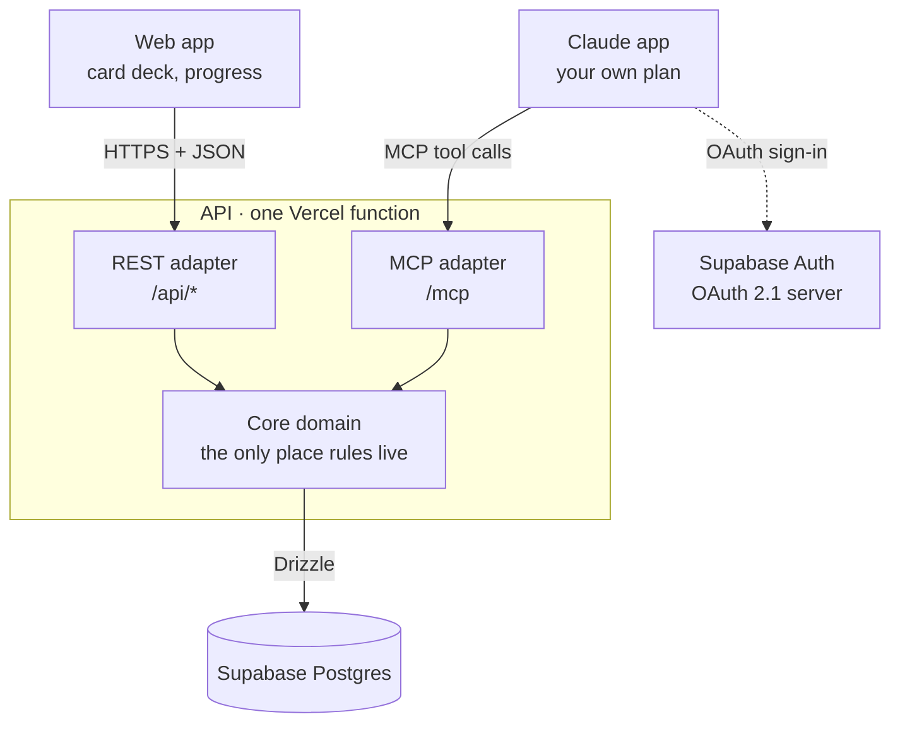

# PrepUp

A focused tracker for the AI buzzwords you're preparing for interviews. Capture a term the moment you hear it, let Claude test you on it, and watch your deck darken as you master it.

PrepUp has **no AI of its own**. All testing runs in your own Claude app through an MCP connector; PrepUp is the system of record.

## How it fits together



**Ports and adapters** (hexagonal architecture): the core knows nothing about HTTP, MCP or Postgres. Both doors call the same `PrepUpService`, so a topic added from your phone through Claude follows the same rules as one added in the browser.

| Package | What it holds |
|---|---|
| `packages/contracts` | Zod schemas shared by REST and MCP: one definition of "a topic" |
| `packages/core` | Scoring and fade rules (pure functions), `PrepUpService`, the repository port |
| `packages/db` | Drizzle schema, SQL migrations, the Postgres adapter |
| `apps/api` | Hono HTTP server: REST routes, the MCP server at `/mcp`, token checks, OAuth consent page |
| `apps/web` | React + Vite web app: the card deck, progress tracker and card pop-up |
| `scripts/build-vercel.mjs` | Builds the web app and the API into Vercel's Build Output format |
| `skills/prepup-coach` | An optional Claude skill that makes testing interview-style |

## The rules

- **One score, 1–5.** 1–4 is how well you understand a topic and answer questions; 5 means you can explain it clearly.
- **Fading.** A score drops one step every 14 days without a Claude test. Only a Claude test (`record_review`) resets that clock.
- **Manual edits** change the score you see, but the clock keeps running, and the edit is labelled in history.
- **A 5 must be earned.** `record_review` rejects a 5 unless `explained: true`, and the database enforces it too.
- **Claude can draft your explanation.** After a test, Claude writes the card's explanation in your voice from your answers. It's saved only if you approve it, in the same transaction as the score, and the card shows that Claude drafted it.
- **Duplicates merge.** "LangChain", "lang chain" and "Lang-Chain" are one card.

## Limits and safety

Built to be shared on free tiers, so one account can't crowd out the rest:

- **Request limits per user:** 120 a minute and 5,000 a day, counted in Postgres so every serverless instance sees the same numbers. Over the limit, the API answers `429` with `Retry-After`.
- **500 topics per deck.** The cap is a core rule, so the web app and Claude hit the same wall.
- **Tokens are checked three ways:** signed by the Supabase project's keys, issued by that project, and carrying the audience Supabase gives signed-in users. Use a Supabase project that serves only PrepUp.
- **Delete my data** (foot of the page) removes every topic, score, explanation and history row you have.
- **Nightly encrypted backups** through GitHub Actions: see [docs/backups.md](docs/backups.md).

All four numbers are environment variables (`.env.example`).

## Design decisions

| Decision | Why | Trade-off |
|---|---|---|
| Ports and adapters | Rules live in one tested place; interfaces are swappable | A little more structure than plain CRUD |
| Append-only `review_events` | Full history; the fade formula can change without migrating data | Scores are computed on read |
| Fade computed at read time | No cron job or worker to run | Recomputed per request; trivial at this size |
| `workspace_id` on every row | Collaboration later is UI work, not a migration | Slightly more setup now |
| Stateless MCP over Streamable HTTP | A fresh MCP server per request, so it runs as a serverless function | No server-pushed notifications (not needed) |
| One Vercel project, one domain | Web app as static files, the whole API as one function; free on Hobby | Cold starts (~1 s) after idle |
| PrepUp as OAuth resource server | Never handles passwords; Supabase issues tokens, we verify them via JWKS | Depends on Supabase's OAuth server (beta) |
| RLS on, no policies | Supabase's public Data API can read nothing; the server enforces scoping in every query | Policies are needed if a client ever queries Supabase directly |

## Running it locally

Requires Node 22+ and pnpm (`corepack enable`).

```bash
pnpm install
pnpm test          # unit + database tests (uses PGlite, no Docker needed)
pnpm typecheck
```

To run the server against a local Postgres:

```bash
cp .env.example .env               # AUTH_MODE=dev for local use
docker run -d --name prepup-db -e POSTGRES_PASSWORD=postgres -e POSTGRES_DB=prepup -p 5432:5432 postgres:17
pnpm db:migrate
pnpm dev           # API on :8080
pnpm dev:web       # web app on :5173 (proxies API paths to :8080)

# Dev auth trusts this header. Any UUID works as a user id.
curl -X POST localhost:8080/api/topics \
  -H 'x-dev-user-id: 11111111-1111-4111-8111-111111111111' \
  -H 'content-type: application/json' -d '{"term":"RAG"}'
```

Deploying: see [docs/deploy-vercel.md](docs/deploy-vercel.md). Google and GitHub sign-in: [docs/social-login.md](docs/social-login.md). `pnpm build:vercel` produces the same `.vercel/output` Vercel deploys.

## Roadmap

- **M0** Auth spike: Claude connects to `/mcp` behind a real Supabase login
- **M1** Core, database and tests
- **M2** Web app: the card deck, hosted with the API on Vercel
- **M3** MCP polish and the PrepUp Coach skill, tested end to end from iPhone
- **M5** Hardening for other users: rate limits, topic caps, audience check, backups, delete my data
- **M6** Generalize: MCP settings page with an editable testing style, open-source docs
- **M7** Topic dependencies ("builds on"), mapped by Claude
- **M8** Public launch
- **v2.5** FSRS scheduling in place of the fixed 14 days
