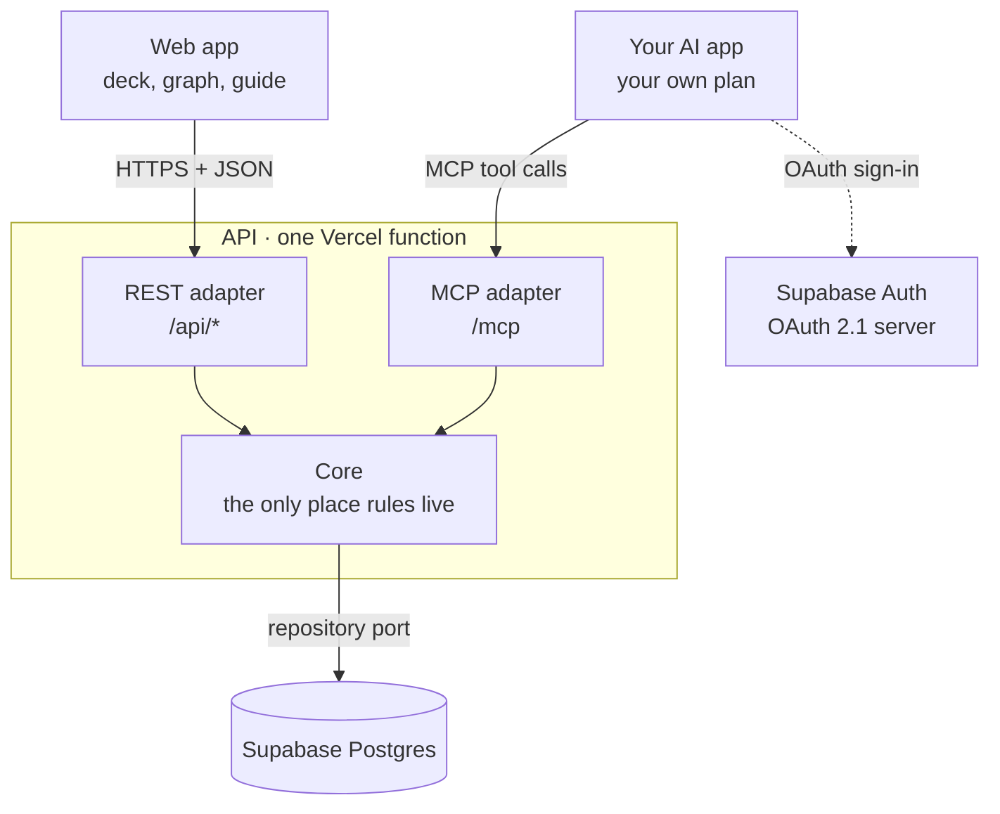

# Architecture

How PrepUp is built, the rules it keeps, and why. Read this before changing behaviour.

## The shape

PrepUp uses **ports and adapters** (also called hexagonal architecture): the core knows nothing about HTTP, MCP or Postgres. The web app and an AI app come in through different doors, but both call the same `PrepUpService`, so a topic added through an assistant follows the same rules as one added in the browser.

PrepUp has no AI of its own and calls no LLM API. An AI app connects over MCP and does the testing; PrepUp stores the result.

## Where things live

| Path | What it holds |
|---|---|
| `packages/contracts` | Zod schemas shared by REST and MCP: one definition of each input |
| `packages/core` | Scoring, fade and link rules as pure functions, `PrepUpService`, the `PrepUpRepository` port, an in-memory repository for tests |
| `packages/db` | Drizzle schema, SQL migrations, the Postgres repository |
| `apps/api` | Hono server: REST routes, the MCP server at `/mcp`, token checks, rate limits, the OAuth consent page |
| `apps/web` | React + Vite web app: deck, graph view, guide, settings, sign-in, costs page |
| `scripts/build-vercel.mjs` | Builds the web app and the API into Vercel's Build Output format |

### Where to make a change

| You want to change | Look in |
|---|---|
| A rule (scoring, fading, links, limits) | `packages/core/src`, with a test in `packages/core/test` |
| The shape of an input | `packages/contracts/src/index.ts` |
| What an assistant can do, or how a tool is described | `TOOLS` in `apps/api/src/mcp.ts` |
| How a test runs | `packages/core/src/testing.ts` |
| A REST route | `apps/api/src/app.ts` |
| A table or column | `packages/db/src/schema.ts`, then `pnpm db:generate` |
| A screen | `apps/web/src/components` |
| A guide page | `apps/web/src/lib/guide.ts` and `apps/web/src/components/guide/pages.tsx` |

## The rules

These are product rules, enforced in the core and covered by tests.

**Scores**

- One score per topic, 1 to 5. 1 to 4 is how well you understand it; 5 means you can explain it clearly.
- Scores are computed from `review_events`, an append-only history. A score is never stored on the topic.
- A score fades one step every 14 days without a test.
- Only a test through the connector (`record_review`) resets the fade clock. A manual edit changes the score you see, is labelled in history, and leaves the clock running.
- A 5 must be earned: `record_review` rejects a 5 unless `explained: true`, and the database enforces it too.

**Assistants**

- Nothing is saved, linked or deleted by an assistant without the user's yes in chat. Each tool description says so.
- An assistant can draft the card's explanation after a test. It is saved only if the user approves it, in the same transaction as the score.
- A test has two layers: fixed rules (one topic at a time, no peeking at saved notes, nothing saved without a yes) and the user's own testing style. A style can never override a fixed rule.
- PrepUp works with any MCP client. Product copy says "your assistant" and names an app only in that app's connect steps.

**Topics and links**

- Duplicates merge: "LangChain", "lang chain" and "Lang-Chain" are one card.
- A topic can build on up to 20 others. Links can't form a loop; the core rejects one and names the topics.
- Links never change a score or the fade clock. They only order things: *Prep now* lists prerequisites first, and a test takes a weaker prerequisite first.

**Data**

- Every query is scoped by `workspace_id`, and by `user_id` for personal data. The one exception is the public costs page, which returns host-wide totals and never a row.
- **Erase all my data** removes every topic, score, explanation and history row a person has.

## Limits and safety

PrepUp is built to be shared on free plans, so one account can't crowd out the rest.

- **Request limits per user:** 120 a minute and 5,000 a day, counted in Postgres so every serverless instance sees the same numbers. Over the limit, the API answers `429` with `Retry-After`.
- **500 topics per deck.** The cap is a core rule, so the web app and the connector hit the same wall.
- **Tokens are checked three ways:** signed by the Supabase project's keys, issued by that project, and carrying the audience Supabase gives signed-in users.
- **Row Level Security is on with no policies**, so Supabase's public Data API can read nothing. The server enforces scoping in every query.
- **The costs page** (`/costs`, public) reads its totals at most once every five minutes, however many people open it.

The limits are environment variables: see [configuration.md](configuration.md).

## Design decisions

| Decision | Why | Trade-off |
|---|---|---|
| Ports and adapters | Rules live in one tested place; the doors are swappable | A little more structure than plain CRUD |
| Append-only `review_events` | Full history; the fade formula can change without migrating data | Scores are computed on read |
| Fade computed at read time | No cron job or worker to run | Recomputed per request; trivial at this size |
| `workspace_id` on every row | Sharing a deck later is UI work, not a migration | Slightly more setup now |
| Stateless MCP over Streamable HTTP | A fresh MCP server per request, so it runs as a serverless function | No server-pushed notifications (not needed) |
| One Vercel project, one domain | Web app as static files, the whole API as one function; free on Hobby | Cold starts (about 1 s) after idle |
| PrepUp as OAuth resource server | The API never handles passwords; Supabase issues tokens and PrepUp verifies them against public keys | Depends on Supabase's OAuth server |
| Loops rejected in the core, not the database | The check needs the whole graph, and the message can name the topics | A link written straight to the database skips the check |
| No routing library in the web app | A handful of paths; `apps/web/src/lib/route.ts` is small and tested | New paths are added by hand |
